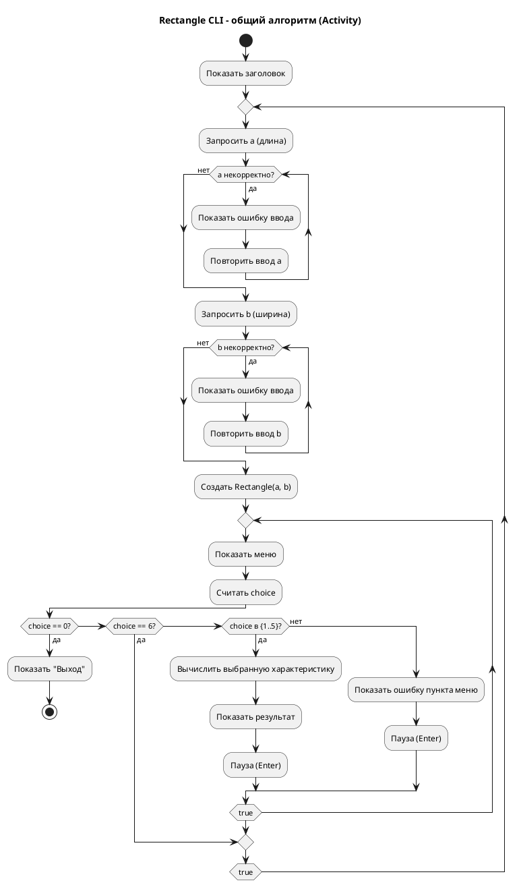
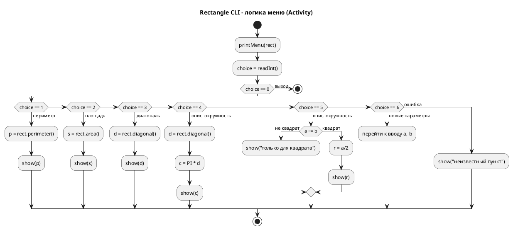
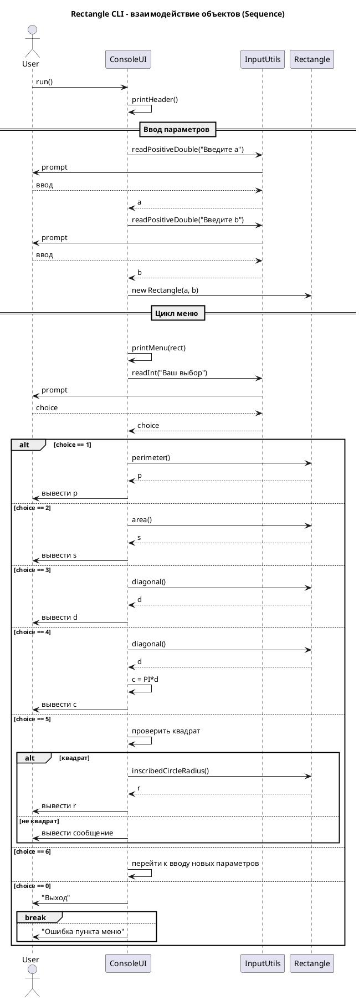
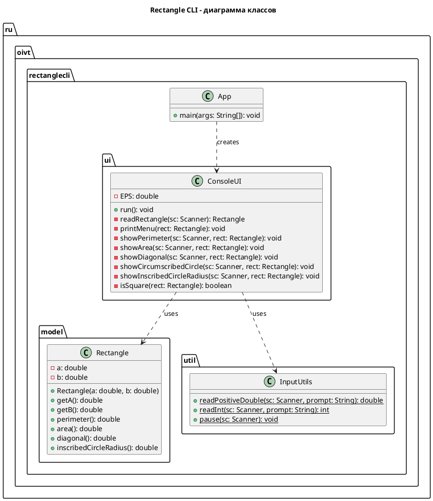
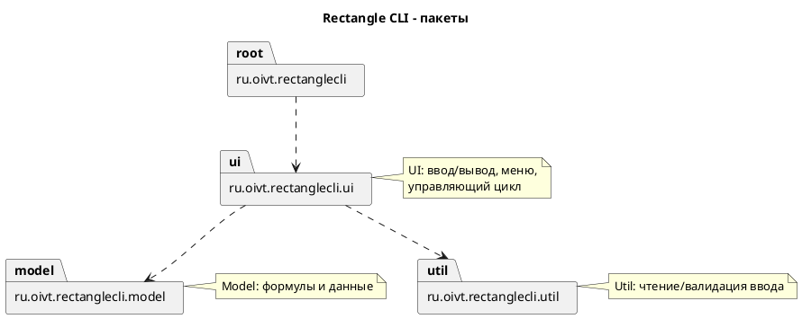

## 1) Общая логика приложения (Activity Diagram)

Показывает основной цикл: ввод параметров → меню → действие → снова меню / новые параметры / выход.



---

## 2) Ветвление меню (внутренняя логика выбора)

Можно как отдельную activity-схему, чтобы студентам было проще “сверять switch-case”.



---

## 3) Sequence Diagram (пользователь ↔ UI ↔ утилиты ↔ модель)

Показывает, кто кого вызывает: `ConsoleUI` управляет процессом, `InputUtils` читает/валидирует, `Rectangle` считает формулы.



---

## 4) Диаграмма классов (Class Diagram)

Фиксируем ответственность и связи.



---

## 5) Диаграмма пакетов (Package Diagram)




---

## Методические указания 

### Логика работы:

1. сначала отрендерить схемы,
    
2. потом писать код «по схемам».
    

### Организация «проектной папки»

```
uml/docs/
  01-activity-main.puml
  02-activity-menu.puml
  03-sequence.puml
  04-class.puml
  05-packages.puml
```


